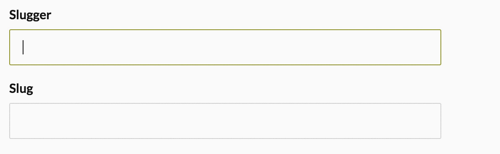

# Slugger

* [Slug Generation](#slug-generation)
* [Custom Slug Separator](#custom-slug-separator)

---

## Slug Generation



Auto-generate a slug from a field. Only populates if the `slug` input is blank.

**Examples**

```slim
= fae_input f, :name, input_class: 'slugger'
= fae_input f, :slug, helper_text: 'Populated from name'
```

## Custom Slug Separator

By default, Fae's slugger used dashes to separate words in the formatted string. However, you can customize this with the following option in `config/initializers/fae.rb`:

```ruby
Fae.setup do |config|

  config.slug_separator = '_'

end
```

Note: the separator reaches the browser through the `fae-slug-separator` meta tag rendered by the admin layouts, and is escaped before it's used in a regex, so characters like `+` are safe.